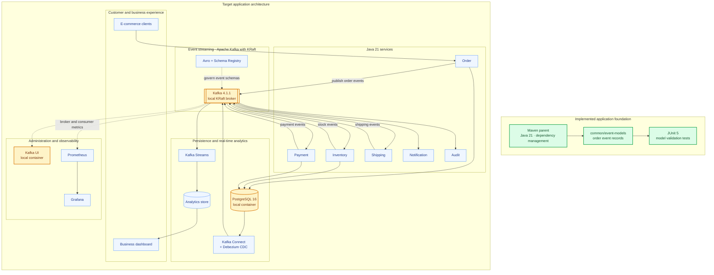

# Distributed E-commerce Event Streaming Platform

A distributed, event-driven e-commerce platform being built with
Java 21 and Apache Kafka.

The project explores distributed systems, event-driven
architecture, real-time data processing, reliability,
observability and business analytics.

---

## 1. Project Vision

The goal is to build a distributed e-commerce platform
where independent microservices communicate through
Apache Kafka.

The platform will process the lifecycle of an order,
from its creation to payment, inventory reservation
and shipping.

It will also provide real-time business analytics
and technical observability.

## 2. Business Perspective

The platform will provide visibility into:

- Total orders.
- Confirmed, pending and cancelled orders.
- Sales volume and revenue.
- Sales per minute.
- Best-selling products.
- Revenue evolution.
- Operational indicators.

A dedicated Business Dashboard will present these
indicators.

## 3. Architecture: Implemented and Planned

The local development foundation is in place: the Maven project,
initial order event models and tests, and a Docker Compose environment
for Kafka, PostgreSQL, and Kafka UI. The application services and
end-to-end event flows are still under development.

The target platform architecture includes:

- Apache Kafka with KRaft.
- Kafka UI for Kafka administration.
- Java 21 microservices.
- PostgreSQL for data persistence.
- Apache Avro and Schema Registry.
- Kafka Streams for real-time analytics.
- Kafka Connect and Debezium for CDC.
- Prometheus for metrics collection.
- Grafana for observability.

## 4. System Architecture

The diagram distinguishes implemented Java code and local infrastructure
from application services and data-processing components that remain
planned. Kafka, PostgreSQL, and Kafka UI are configured for local use;
the application does not yet publish or consume Kafka messages.



See the [detailed architecture](docs/architecture/system-architecture.md)
for component responsibilities and design principles.

## 5. Microservices

The planned services are:

| Service | Responsibility |
|---|---|
| Order Service | Order lifecycle management |
| Inventory Service | Product stock management |
| Payment Service | Payment processing |
| Shipping Service | Shipment management |
| Notification Service | Customer notifications |
| Audit Service | Event tracking and auditing |

## 6. Technology Stack

| Technology | Purpose | Status |
|---|---|---|
| Java 21 | Application development | Configured in Maven; order event models implemented |
| Maven | Build and dependency management | Implemented |
| Apache Kafka 4.1.1 | Event streaming | Configured locally; not yet used by application code |
| PostgreSQL 16 | Data persistence | Configured locally; application persistence not implemented |
| Docker Compose | Local infrastructure | Kafka, PostgreSQL, and Kafka UI configured |
| Kafka UI | Kafka administration | Configured locally |
| Kafka Streams | Stream processing | Planned |
| Avro and Schema Registry | Event serialization and schema management | Planned |
| Kafka Connect and Debezium | Data integration and CDC | Planned |
| Prometheus and Grafana | Metrics and observability | Planned |
| Git | Version control | Used for the repository |

## 7. Project Structure

```text
distributed-ecommerce/
├── .gitignore
├── README.md
├── pom.xml
├── .github/
│   └── modernize/
│       ├── java-25-runtime-upgrade/
│       │   ├── plan.md
│       │   └── .metadata/tasks.json
│       └── rearchitecture/
│           └── artifacts/
│               ├── architecture_index.md
│               ├── project-structure.md
│               ├── tech-stack.md
│               ├── unit_graph.yaml
│               ├── shared_modules.yaml
│               ├── cross_unit_state.yaml
│               ├── wire_contracts.yaml
│               └── units/platform-info-api/
│                   ├── behavior.yaml
│                   ├── bindings.yaml
│                   └── unit_decomposition.yaml
├── common/
│   └── event-models/
│       ├── pom.xml
│       └── src/
│           ├── main/java/com/ecommerce/events/
│           │   ├── OrderCancelled.java
│           │   ├── OrderConfirmed.java
│           │   ├── OrderCreated.java
│           │   ├── OrderItem.java
│           │   └── PlatformInfo.java
│           └── test/java/com/ecommerce/events/
│               ├── OrderCancelledTest.java
│               ├── OrderConfirmedTest.java
│               ├── OrderCreatedTest.java
│               ├── OrderItemTest.java
│               └── PlatformInfoTest.java
├── infrastructure/
│   └── docker/
│       └── docker-compose.yml
├── services/
│   ├── notification-service/
│   ├── order-service/
│   ├── payment-service/
│   └── product-service/
├── stream-processing/
│   └── order-analytics/
├── scripts/  (empty)
├── docs/
│   ├── adr/
│   │   └── ADR-001-technology-stack.md
│   └── architecture/
│       └── system-architecture.md
```

The root Maven project currently aggregates only `common/event-models`.
The service and `stream-processing/order-analytics` directories are
empty scaffolding and are not Maven modules yet. `scripts/` is empty.
The `.github/modernize` files contain planning and architecture
artifacts, not application code. Generated build output under `target/`
and local IDE settings are not part of the tracked project structure.

## 8. Current Implementation

The current codebase provides a Java 21 and Maven foundation, initial
order event models, and local development infrastructure.

- A root Maven parent project centralizes Java, Kafka client,
  JUnit and build plugin versions.
- The `common/event-models` module is configured as a JAR.
- `OrderItem` models a product line with a product ID, positive
  quantity, and non-negative unit price; it calculates the subtotal.
- `OrderCreated` captures the order, customer, total, currency, and
  creation time, with constructor validation.
- `OrderConfirmed` captures an order confirmation and timestamp.
- `OrderCancelled` captures a cancellation reason and timestamp.
- `PlatformInfo.getName()` returns the platform name.
- JUnit 5 tests cover event construction, validation rules, the
  order-item subtotal, and the platform name.
- Docker Compose defines a local Kafka 4.1.1 KRaft broker, PostgreSQL
  16, and Kafka UI.
- `docs/adr/ADR-001-technology-stack.md` records the selected
  technologies and architectural constraints.
- `docs/architecture/system-architecture.md` documents the
  target system architecture and its incremental implementation
  strategy.

Kafka producer/consumer integration, application persistence,
microservices, schema management, stream processing, analytics,
and observability are not implemented yet. The PostgreSQL Compose
configuration is for local development only and is not production-ready.

## 9. Reliability and Distributed Systems

The project will explore:

- Event-driven architecture.
- Consumer groups and partitioning.
- Message delivery guarantees.
- Idempotent processing.
- Retry and Dead Letter Queues.
- Saga pattern.
- Outbox and Inbox patterns.
- Eventual consistency.
- Failure recovery.

## 10. Observability

Prometheus and Grafana will be used to monitor:

- Kafka brokers.
- Consumer lag.
- Throughput.
- Processing latency.
- Infrastructure performance.

## 11. Project Roadmap

| Phase | Description |
|---|---|
| 1 | Infrastructure and Kafka Fundamentals |
| 2 | Kafka Internals |
| 3 | Event-driven Architecture |
| 4 | Event Contracts and Schema Registry |
| 5 | Reliability |
| 6 | Distributed Systems |
| 7 | Kafka Streams |
| 8 | Kafka Connect and Debezium |
| 9 | Observability |
| 10 | Performance |
| 11 | Security and Deployment |

## 12. Project Status

**Current phase:** Phase 1 - Infrastructure and Kafka Fundamentals.

**Current stage:** Java 21/Maven foundation; four order-related
records (`OrderItem`, `OrderCreated`, `OrderConfirmed`, and
`OrderCancelled`) with JUnit tests; local Docker Compose services for
Kafka, PostgreSQL, and Kafka UI; and architecture documentation.

## 13. Building and Testing

Requirements: JDK 21 and Maven to build and test. Docker with the
Compose plugin is required to run the local infrastructure.

Run all Maven module tests from the repository root:

```shell
mvn test
```

Start the local Kafka, PostgreSQL, and Kafka UI containers:

```shell
docker compose -f infrastructure/docker/docker-compose.yml up -d
```

Check container status:

```shell
docker compose -f infrastructure/docker/docker-compose.yml ps
```

Kafka UI is available at `http://localhost:8080`, Kafka is exposed at
`localhost:9092`, and PostgreSQL is exposed at `localhost:5433`.
These services are not yet connected to the Java application.

Stop the local containers without deleting their persisted data:

```shell
docker compose -f infrastructure/docker/docker-compose.yml down
```

## 14. Learning Objectives

This project aims to develop practical knowledge of Apache Kafka,
distributed systems, event-driven microservices, real-time data
engineering, stream processing, data integration, observability
and distributed system reliability.

## 15. License

...
