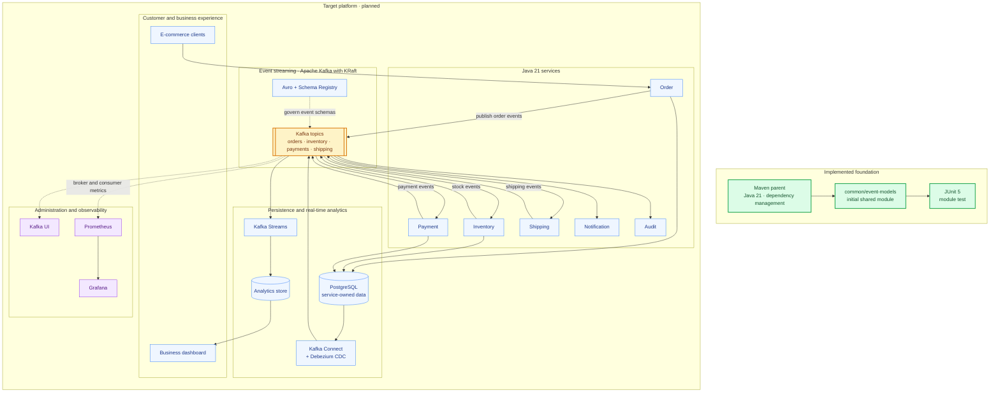

# Distributed E-commerce Event Streaming Platform

A distributed, event-driven e-commerce platform built with
Java 21 and Apache Kafka.

The project explores distributed systems, event-driven
architecture, real-time data processing, reliability,
observability and business analytics.

---

## 1. Project Vision

The goal is to build a distributed e-commerce platform
where independent microservices communicate through
Apache Kafka.

The platform will process the lifecycle of an order,
from its creation to payment, inventory reservation
and shipping.

It will also provide real-time business analytics
and technical observability.

## 2. Business Perspective

The platform will provide visibility into:

- Total orders.
- Confirmed, pending and cancelled orders.
- Sales volume and revenue.
- Sales per minute.
- Best-selling products.
- Revenue evolution.
- Operational indicators.

A dedicated Business Dashboard will present these
indicators.

## 3. Planned Technical Architecture

The planned platform architecture includes:

- Apache Kafka with KRaft.
- Kafka UI for Kafka administration.
- Java 21 microservices.
- PostgreSQL for data persistence.
- Apache Avro and Schema Registry.
- Kafka Streams for real-time analytics.
- Kafka Connect and Debezium for CDC.
- Prometheus for metrics collection.
- Grafana for observability.

## 4. System Architecture

The diagram below shows the **target architecture**. Only the Maven
foundation and the initial `event-models` module are implemented today;
the services and infrastructure in the target design remain planned.



See the [detailed architecture](docs/architecture/system-architecture.md)
for component responsibilities and design principles.

## 5. Microservices

The planned services are:

| Service | Responsibility |
|---|---|
| Order Service | Order lifecycle management |
| Inventory Service | Product stock management |
| Payment Service | Payment processing |
| Shipping Service | Shipment management |
| Notification Service | Customer notifications |
| Audit Service | Event tracking and auditing |

## 6. Planned Technology Stack

| Technology | Purpose |
|---|---|
| Java 21 | Application development |
| Maven | Build and dependency management |
| Apache Kafka | Event streaming |
| Kafka Streams | Stream processing |
| Avro | Event serialization |
| PostgreSQL | Data persistence |
| Docker | Infrastructure |
| Kafka UI | Kafka administration |
| Prometheus | Metrics collection |
| Grafana | Observability |
| Git | Version control |

## 7. Project Structure

```text
distributed-ecommerce/
├── .gitignore
├── README.md
├── pom.xml
├── common/
│   └── event-models/
│       ├── pom.xml
│       └── src/
│           ├── main/java/com/ecommerce/events/
│           │   └── PlatformInfo.java
│           └── test/java/com/ecommerce/events/
│               └── PlatformInfoTest.java
├── docs/
│   ├── adr/
│   │   └── ADR-001-technology-stack.md
│   └── architecture/
│       └── system-architecture.md
```

The root Maven project aggregates the `common/event-models`
module. Generated build output under `target/` and local IDE
settings are not part of the tracked source tree. The
`infrastructure/docker` and `scripts` directories remain planned
and will appear here when they contain versioned files.

## 8. Current Implementation

The current codebase provides the initial Java 21 and Maven
foundation:

- A root Maven parent project centralizes Java, Kafka client,
  JUnit and build plugin versions.
- The `common/event-models` module is configured as a JAR.
- `PlatformInfo.getName()` returns the platform name.
- A JUnit 5 test verifies the platform name.
- `docs/adr/ADR-001-technology-stack.md` records the selected
  technologies and architectural constraints.
- `docs/architecture/system-architecture.md` documents the
  target system architecture and its incremental implementation
  strategy.

Kafka messaging, persistence, services and the infrastructure
described below are documented as goals, but are not implemented
yet.

## 9. Reliability and Distributed Systems

The project will explore:

- Event-driven architecture.
- Consumer groups and partitioning.
- Message delivery guarantees.
- Idempotent processing.
- Retry and Dead Letter Queues.
- Saga pattern.
- Outbox and Inbox patterns.
- Eventual consistency.
- Failure recovery.

## 10. Observability

Prometheus and Grafana will be used to monitor:

- Kafka brokers.
- Consumer lag.
- Throughput.
- Processing latency.
- Infrastructure performance.

## 11. Project Roadmap

| Phase | Description |
|---|---|
| 1 | Infrastructure and Kafka Fundamentals |
| 2 | Kafka Internals |
| 3 | Event-driven Architecture |
| 4 | Event Contracts and Schema Registry |
| 5 | Reliability |
| 6 | Distributed Systems |
| 7 | Kafka Streams |
| 8 | Kafka Connect and Debezium |
| 9 | Observability |
| 10 | Performance |
| 11 | Security and Deployment |

## 12. Project Status

**Current phase:** Phase 1 - Infrastructure and Kafka Fundamentals.

**Current stage:** Maven foundation, initial shared event-models
module and test, plus technology-stack and target-architecture
documentation.

## 13. Building and Testing

Requirements: JDK 21 and Maven.

Run all module tests from the repository root:

```shell
mvn test
```

## 14. Learning Objectives

This project aims to develop practical knowledge of Apache Kafka,
distributed systems, event-driven microservices, real-time data
engineering, stream processing, data integration, observability
and distributed system reliability.

## 15. License

...
