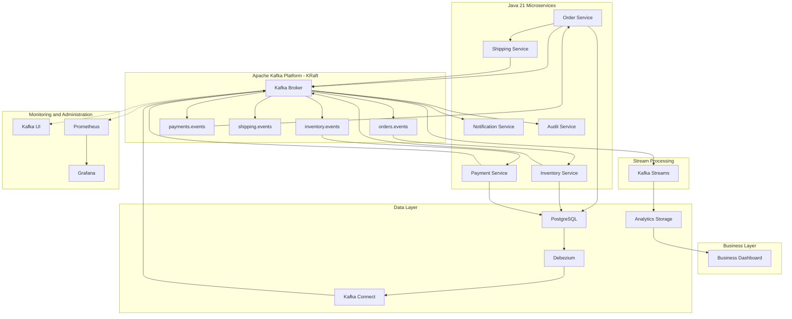

# Distributed E-commerce Event Streaming Platform

## 1. Architecture Overview

This document describes the high-level architecture
of the Distributed E-commerce Event Streaming Platform.

The platform follows an Event-Driven Architecture (EDA)
using Apache Kafka as its central event streaming platform.

## 2. System Architecture

## 3. Architecture Components

| Component | Responsibility |
|---|---|
| Apache Kafka | Event streaming and communication |
| Kafka UI | Kafka administration |
| Order Service | Order lifecycle management |
| Inventory Service | Stock management |
| Payment Service | Payment processing |
| Shipping Service | Shipment management |
| Notification Service | Customer notifications |
| Audit Service | Event auditing |
| PostgreSQL | Persistent data storage |
| Debezium | Change Data Capture |
| Kafka Connect | Data integration |
| Kafka Streams | Real-time analytics |
| Prometheus | Metrics collection |
| Grafana | Monitoring and dashboards |
| Business Dashboard | Business indicators |

## 4. Architectural Principles

- Event-Driven Architecture.
- Independent Java microservices.
- Asynchronous communication.
- Loose coupling between services.
- Event-based integration.
- Separation of business and technical monitoring.
- Distributed data ownership.
- Eventual consistency.

## 5. Implementation Strategy

The architecture will be implemented incrementally.

The initial environment will use a single Kafka broker
with KRaft and Kafka UI.

Additional infrastructure and services will be
introduced progressively throughout the project roadmap.
